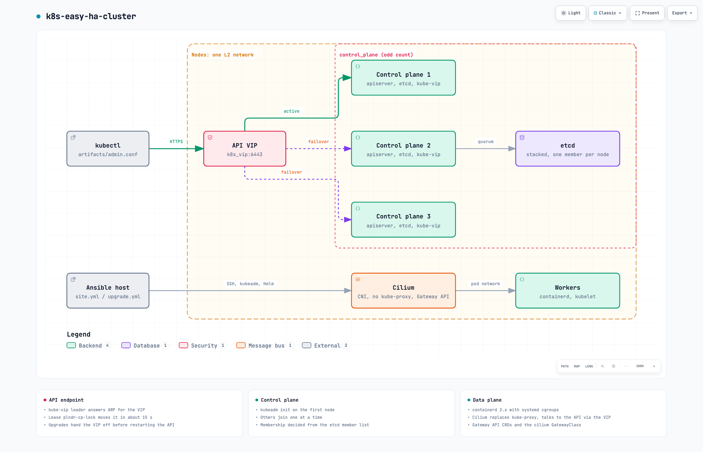

# k8s-easy-ha-cluster

Ansible playbooks for a highly available Kubernetes cluster on bare metal or VMs (amd64 and arm64).
Plain upstream components, no wrappers: kubeadm, containerd, stacked etcd, kube-vip for the API
endpoint and Cilium as CNI with Gateway API.



## What you get

- Kubernetes 1.37 from pkgs.k8s.io, packages pinned and held.
- Three (or any odd number of) control plane nodes with stacked etcd, joined one at a time.
- A virtual IP for the API server announced by kube-vip (ARP, leader election), no external load balancer.
- containerd 2.x and runc from upstream releases, checksums verified, systemd cgroups.
- Cilium with kube-proxy replacement and Gateway API CRDs.
- Optional addons: metrics-server and cert-manager.
- Rolling upgrades without API downtime (with three or more control plane nodes), safe re-runs (a second run changes nothing) and recovery of half-joined nodes.

Supported nodes: Ubuntu 22.04 and 24.04 (Debian 12 is accepted but not tested yet) on amd64 or arm64.
The machine running Ansible needs ansible-core 2.16 or newer.

## Quick start

```sh
ansible-galaxy collection install -r requirements.yml
cp -r inventory/example inventory/mycluster
# edit inventory/mycluster/hosts.yml and group_vars/all.yml (addresses, k8s_vip, k8s_vip_interface)
ansible-playbook -i inventory/mycluster/hosts.yml site.yml
export KUBECONFIG=$PWD/inventory/mycluster/artifacts/admin.conf
kubectl get nodes
```

The full walkthrough is in [docs/quickstart.md](docs/quickstart.md).

## Playbooks

| Playbook | What it does |
| --- | --- |
| `site.yml` | Deploys the cluster or brings it back to the declared state. Safe to re-run. |
| `upgrade.yml` | Upgrades to a new `k8s_version`, one node at a time. See [docs/upgrade.md](docs/upgrade.md). |
| `reset.yml` | Wipes the cluster from all nodes. Needs `-e reset_confirm=true`. |

## Documentation

- [Quick start](docs/quickstart.md)
- [Architecture](docs/architecture.md)
- [Variables](docs/variables.md)
- [Upgrades](docs/upgrade.md)
- [Troubleshooting](docs/troubleshooting.md)
- [Local test stand on Lima](docs/quickstart.md#local-stand-on-lima)

## History

The previous version (Kubernetes 1.27, external etcd, HAProxy on every node) is kept under the
`legacy-2024` tag.
